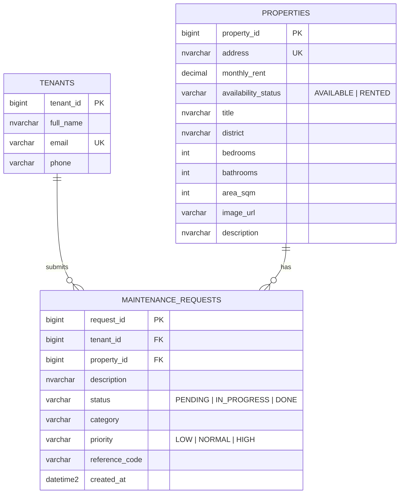

# ERD - AnCu Rentals

Mermaid diagram (GitHub renders it automatically). PK = primary key, FK = foreign key, UK = unique.

Relationships: one tenant -> many requests; one property -> many requests; each request references exactly one tenant and one property.
Foreign keys use `NO ACTION`, so a tenant or property that still has requests cannot be deleted.

To get a PNG for the slides: paste `docs/ancu-rentals.dbml` into <https://dbdiagram.io> and export the image.
